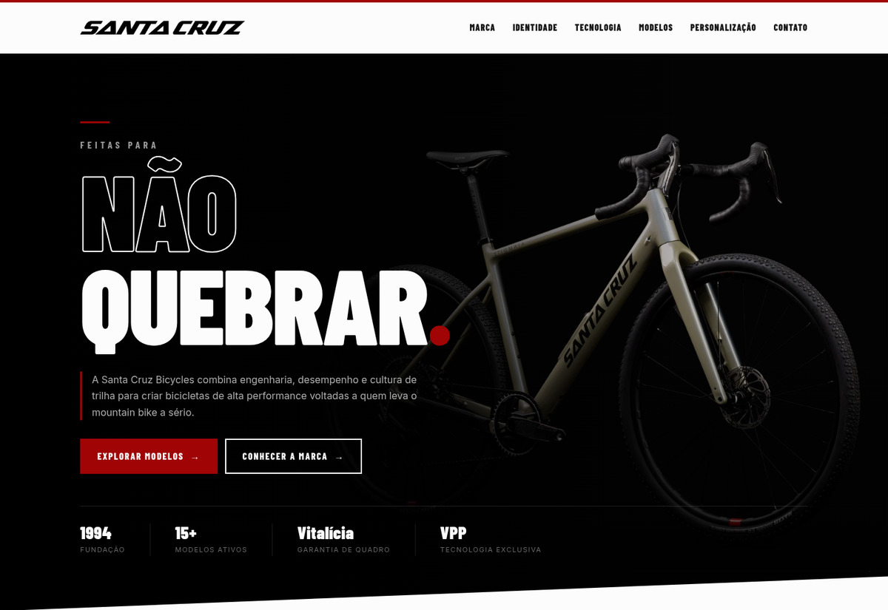

# Santa Cruz Bicycles — Landing Page

Landing page acadêmica inspirada na identidade visual da **Santa Cruz Bicycles**, fabricante californiana de mountain bikes de alta performance fundada em 1994.



## Sobre o projeto

Exercício acadêmico de análise e recriação de identidade visual. A página apresenta a marca, sua linguagem visual, tecnologias, portfólio de modelos e possibilidades de personalização, com uma estética forte, esportiva e direta: preto, branco e vermelho, tipografia condensada em caixa alta e as bicicletas como protagonistas.

Todo o site está em um único arquivo `index.html`, sem frameworks, sem build e sem dependências para instalar.

## Seções

| Seção | Conteúdo |
|---|---|
| **Início** | Hero "Feitas para não quebrar." com destaques da marca |
| **A marca** | História, fundação em 1994 e filosofia da empresa |
| **Identidade visual** | Logotipo, estilo, contraste e uso do vermelho |
| **Tecnologia** | Suspensão VPP, carbono C e CC e garantia vitalícia |
| **Modelos** | Megatower, Bronson, Hightower e V10 |
| **Personalização** | Cores disponíveis (interativas), materiais de quadro, rodas e build kits |
| **Público e experiência** | Jornada do consumidor em quatro etapas |
| **Contato** | Chamada final com link para o site oficial |

## Destaques do design

- Título do hero com contraste entre letras vazadas e sólidas
- Cortes diagonais entre as seções escuras e números decorativos em contorno
- Animações de entrada suaves ao rolar a página
- Seletor de cores: o nome aparece ao passar o mouse ou clicar
- Layout responsivo para desktop, tablet e celular
- Respeita a preferência do sistema por menos movimento (`prefers-reduced-motion`) e funciona com navegação por teclado

## Tecnologias

- HTML5 e CSS3 (custom properties, grid, flexbox, `clip-path`, `mix-blend-mode`)
- JavaScript puro (IntersectionObserver para as animações)
- Google Fonts: [Barlow Condensed](https://fonts.google.com/specimen/Barlow+Condensed) e [Inter](https://fonts.google.com/specimen/Inter)

## Como visualizar

Abra o arquivo `index.html` diretamente no navegador, ou sirva a pasta localmente:

```bash
python3 -m http.server 8080
# depois acesse http://localhost:8080
```

## Estrutura

```
.
├── index.html                    # página completa (HTML, CSS e JS)
├── favicon.png
├── logo-santacruz.png            # logo do cabeçalho
├── logo-santacruz-branco.png     # logo do rodapé
├── MY27_*.webp                   # fotos de produto com fundo transparente
├── bikeazul.png, bikeverde.png,
│   images.png                    # fotos dos cards de modelos
└── docs/preview.png              # imagem deste README
```

## Créditos

Projeto desenvolvido por [g-fraga](https://github.com/g-fraga) como exercício acadêmico, sem fins comerciais.

A marca Santa Cruz Bicycles, o logotipo e as imagens dos produtos pertencem aos seus respectivos proprietários. Conteúdo baseado em material de análise e nos sites oficiais:

- [Santa Cruz Bicycles Brasil](https://www.santacruzbikes.com.br/)
- [Santa Cruz Bicycles Global](https://www.santacruzbicycles.com/)
